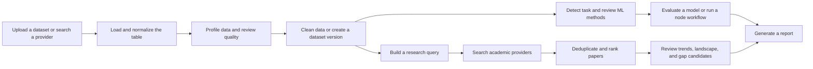
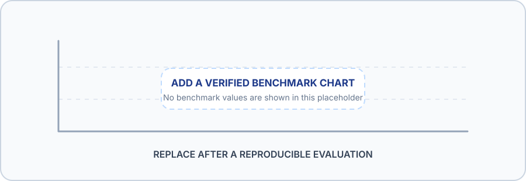

<div align="center">
  
  <br />
  
  <br /><br />

  <a href="https://github.com/NezzyGremory/Dataset-Research"></a>
  <a href="https://github.com/NezzyGremory/Dataset-Research/blob/main/LICENSE"></a>
  <a href="https://github.com/NezzyGremory/Dataset-Research/commits/main"></a>
  <a href="https://github.com/NezzyGremory/Dataset-Research/stargazers"></a>
  
  <!-- ISI: set an official project status (for example, active, maintenance, or archived) when confirmed. -->
</div>

**Data Overview Research & Assistant (DORA)** is the Python desktop application in this repository. It brings local tabular-data exploration, machine-learning workflow tools, and academic-literature discovery into one workspace. The GitHub repository is named `Dataset-Research`.

## Table of Contents

- [About the Project](#about-the-project)
- [Features](#features)
- [Dataset](#dataset)
- [Project Structure](#project-structure)
- [Tech Stack](#tech-stack)
- [Installation](#installation)
- [Usage](#usage)
- [Workflow](#workflow)
- [Results and Analysis](#results-and-analysis)
- [Roadmap](#roadmap)
- [Contributing](#contributing)
- [License](#license)
- [Contact](#contact)
- [Support](#support)

## About the Project

DORA helps researchers inspect and prepare tabular datasets, explore machine-learning approaches, and connect a research topic to relevant academic publications. Dataset loading, profiling, cleaning, and model evaluation are implemented in the desktop application; online dataset and paper providers require an internet connection.

The project is a research-support tool rather than a source of authoritative scientific conclusions. Review the original dataset, paper, provider metadata, and model evaluation before relying on an output.

## Features

### Dataset exploration

- Load local CSV, TSV, Excel (`.xlsx` / `.xls`), JSON, or Parquet files.
- Search and download tabular datasets from Kaggle and Hugging Face through the Dataset Search page.
- Review dataset shape, column types, descriptive statistics, missing values, duplicates, outliers, correlations, and data-quality signals.
- Create cleaned dataset versions and keep dataset revisions in the local workspace.
- Review ML-readiness information such as target candidates, class balance, data leakage signals, and preprocessing guidance.

### Machine-learning workflows

- Detect candidate task types and target columns from dataset information.
- Review method recommendations and available model-evaluation metrics.
- Build, validate, save, and run visual workflows in the Node Editor; export workflow code and notebook artifacts from its available actions.
- Edit and execute Python analysis cells in the notebook-style Editor Analysis page, and open or save `.ipynb` notebooks.

### Academic research

- Search paper metadata through provider adapters for OpenAlex, Crossref, Semantic Scholar, Europe PMC, and OpenAIRE.
- Review ranked and de-duplicated papers, publication metadata, research trends, landscape summaries, and candidate research gaps.
- Use separate journal-index and accreditation checks where the configured provider supports them.
- Generate a report from available dataset, ML, and research information.
- Use local explainers and optional Gemini-backed explanations where configured.

<details>
  <summary>More about the evaluation tools</summary>

  The separate `evaluation/` package contains runners for task/domain detection, method recommendations, quality, robustness, performance, ranking and gap labels, and deduplication checks. It can save machine-readable evaluation reports under the local `data/evaluation/results/` directory. Some research-ranking evaluations require human-labeled inputs; the evaluation protocol describes the requirements and interpretation limits.
</details>

## Dataset

This repository is an application, not a dataset release. There is no fixed research dataset, notebook, row count, or feature schema committed with the source. Row and column counts depend on the file selected by the user or the provider result downloaded at runtime.

| Dataset source | Formats | Rows and columns | How to obtain it |
| --- | --- | --- | --- |
| User-provided tabular data | CSV, TSV, XLSX, XLS, JSON, Parquet | Varies by file; the application displays the loaded shape and column names. | Select a local file in the Dataset page. |
| Public community datasets | Kaggle and Hugging Face results; available file types depend on the provider entry. | Varies by dataset and selected file. | Search by keyword in **Dataset Search**, review the source page and license, then download. |
| Evaluation datasets | OpenML IDs and provenance are described by the local evaluation manifest when available; downloaded copies are stored as CSV under `data/evaluation/`. | Varies by dataset ID and split. No single row or feature count applies to the suite. | Provide `evaluation/manifests/dataset_ground_truth.csv`, then run the evaluation download command below. |

The dataset loader accepts files up to **100 MB**. Dataset Search can directly download JSONL files from supported provider entries, but `.jsonl` is not one of the dataset loader's accepted input suffixes; convert it to a supported format before importing it into analysis.

Evaluation manifests, downloaded datasets, application databases, and evaluation results are local runtime data and are not included in the versioned source. Do not commit user data, provider credentials, or `.env` files.

<!-- ISI: if this repository is intended to ship a fixed research dataset, document its canonical source, license, version, row count, target, and important feature columns here. -->

## Project Structure

```text
.
├── app/
│   ├── ai/                 Local and optional remote explainers
│   ├── analyzer/           Dataset loading, profiling, cleaning, and quality analysis
│   ├── core/               App configuration, constants, exceptions, and logging
│   ├── dataset_search/     Kaggle and Hugging Face search/download clients
│   ├── ml/                 Task detection, recommendations, evaluation, and graph engine
│   ├── nlp/                Keyword, domain, and text-similarity helpers
│   ├── reports/            Report generation and HTML template
│   ├── research/           Paper providers, ranking, trends, landscape, and gap analysis
│   ├── storage/            SQLite repositories and dataset-version management
│   └── ui/                 PySide6 pages, notebook editor, Node Editor, QSS, and assets
├── assets/                 README title and results-placeholder illustrations
├── docs/                   Evaluation, installer, release, and implementation notes
├── evaluation/             Evaluation runners, metrics, and protocol (data manifest supplied separately)
├── installer/              Inno Setup installer definition
├── scripts/                Project utility scripts
├── tests/                  Automated tests
├── tools/                  Screenshot and documentation helpers
├── .env.example            Example environment configuration
├── Dataset Research.spec  PyInstaller build specification
├── LICENSE                 MIT license
├── pytest.ini              Test discovery configuration
├── requirements.txt        Desktop application dependencies
├── requirements-build.txt  Windows packaging dependencies
├── run.py                  Application launcher
└── build_windows_installer.bat  Windows packaging entry point
```

The application creates a local `data/` workspace for databases, downloads, dataset versions, and evaluation artifacts. That runtime data is intentionally excluded from the repository.

## Tech Stack

<div>
  
  
  
  
  
  
  
  
  
  
</div>

The dependency list also includes `python-dotenv`, `Jinja2`, `openpyxl`, and `xlrd`. `pytest`, Pillow, and PyInstaller are included in the project requirement files for development or packaging workflows. Dependency versions in `requirements.txt` are not pinned.

## Installation

The steps below use Windows PowerShell, matching the repository's documented Windows installer workflow.

```powershell
git clone https://github.com/NezzyGremory/Dataset-Research.git
Set-Location Dataset-Research

python -m venv .venv
.\.venv\Scripts\Activate.ps1

python -m pip install --upgrade pip
python -m pip install -r requirements.txt
python run.py
```

<!-- ISI: confirm and state the officially supported Python version range. The requirements file does not pin a Python version. -->

If PowerShell blocks virtual-environment activation, call its interpreter directly:

```powershell
.\.venv\Scripts\python.exe -m pip install -r requirements.txt
.\.venv\Scripts\python.exe run.py
```

<details>
  <summary>Build the Windows installer</summary>

  The installer documentation lists Windows 10 or 11 (64-bit), Python, a project virtual environment, and Inno Setup 6 as prerequisites.

  ```powershell
  .\.venv\Scripts\python.exe -m pip install -r requirements-build.txt
  .\build_windows_installer.bat
  ```

  Build output is written under `hasil_compile/`. See [`docs/WINDOWS_INSTALLER.md`](docs/WINDOWS_INSTALLER.md) for packaging and data-location details.
</details>

## Usage

### Open the desktop application

```powershell
python run.py
```

The command starts the DORA desktop workspace. From there, choose a dataset, inspect its profile, and continue into analysis, ML workflows, or academic research.

### Run the optional evaluation workflow

The evaluation runner requires its manifest and relevant local datasets/labels. These inputs are not bundled in the Git repository. With the manifest available, download the DEV split and run a quick offline pass against the local cache:

```powershell
python -m evaluation.download_datasets --dev
python -m evaluation.run --only all --dev --quick --offline
```

Example downloader output (the dataset count depends on the supplied manifest):

```text
Split DEV: <N> dataset; SHA-256 dicatat.
```

The evaluation runner writes a JSON report under `data/evaluation/results/`. Modules can report `SELESAI`, `TIDAK DIJALANKAN`, or `GAGAL` depending on available inputs; skipped or failed components must not be interpreted as a zero score. See [`docs/EVALUATION_PROTOCOL.md`](docs/EVALUATION_PROTOCOL.md) before citing benchmark results.

## Workflow



The diagram describes available application paths. Provider coverage, dataset suitability, model quality, and research-gap candidates depend on the selected inputs and should be reviewed by the researcher.

## Results and Analysis

The repository contains analysis and evaluation code, but no published aggregate benchmark report or fixed dataset. No accuracy, ranking, performance, or research-gap score is asserted here.

| Area | What the project computes or presents | Quantitative result in the repository |
| --- | --- | --- |
| Dataset analysis | Profiles, quality indicators, missing-value and duplicate checks, outlier/correlation views | No fixed dataset-level result; input-dependent |
| ML workflows | Task/target candidates, method suggestions, and available model metrics | No benchmark score published in this README |
| Academic research | Provider results, paper ranking, landscape/trend summaries, and gap candidates | Live/provider-dependent; no human-labeled aggregate result published here |
| Evaluation package | Reproducibility-oriented evaluation reports for configured datasets and labels | Local reports are generated at runtime and are not versioned |

<p align="center">
  
</p>

<!-- ISI: replace the placeholder chart only after committing or linking a reproducible evaluation report with dataset provenance, split, sample size, and uncertainty. -->

## Roadmap

### Available in the source

- [x] Local tabular-data loading, profiling, cleaning, and quality review
- [x] Dataset discovery through Kaggle and Hugging Face
- [x] ML task detection, recommendations, evaluation, and visual node workflows
- [x] Academic paper discovery, ranking, trend/landscape analysis, and gap candidates
- [x] Report generation and a separate evaluation runner

### Follow-up documentation and evaluation

- [ ] Publish reproducible quantitative results after the required benchmark inputs and human labels are prepared
- [ ] Confirm the project's official maintenance status and Python support range
- [ ] Add a fixed dataset card only if the repository begins distributing a canonical dataset

<!-- ISI: replace or extend these follow-up items with the maintainers' confirmed priorities. -->

## Contributing

Contributions are welcome. For a change:

1. Open an issue or discussion describing the problem or proposed improvement.
2. Create a focused branch and keep changes scoped to the relevant application area.
3. Add or update tests for behavior changes, and run the checks relevant to the change.
4. Open a pull request with a short summary and verification notes.

Do not include private datasets, generated evaluation results, credentials, or `.env` files in a contribution.

## License

This project is licensed under the [MIT License](LICENSE). Third-party packages, dataset providers, and academic-data services may have their own terms and licenses.

## Contact

- **Author:** Abdul muhis
- **Project repository:** [NezzyGremory/Dataset-Research](https://github.com/NezzyGremory/Dataset-Research)
- **Author profile:** Not listed in the repository. <!-- ISI: add the author's confirmed GitHub profile URL. -->
- **Other contact:** Not listed. <!-- ISI: add an email, website, or ORCID if desired. -->

## Support

<div align="center">
  <p>If DORA is useful to your work, consider giving the repository a star.</p>
  <a href="https://github.com/NezzyGremory/Dataset-Research/stargazers"></a>
  <p><sub>Use results responsibly, cite original data and papers, and share reproducible improvements.</sub></p>
</div>
